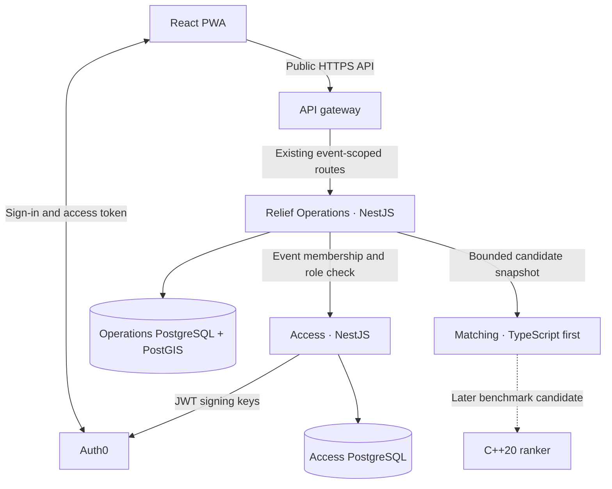

# Rebuild microservices architecture

Proposed service boundaries for review · 13 November 2026

Rebuild will use independently deployable backend services in the existing monorepo. This plan supersedes the modular monolith and in-process native matcher in the original engineering plan. The [product contract](PRODUCT-CONTRACT.md) defines the demo workflow, and the [data and API contract](DATA-API-CONTRACT.md) defines its public endpoints and consistency rules.

## Service ownership

| Component | Responsibilities and data |
|---|---|
| API gateway | Public routing, request IDs, request-size limits and route-specific rate limits. Domain services enforce authorization. |
| Access | Validates the Auth0 token and maps issuer and subject to an application user. Owns application users and event memberships. Returns the actor and current event role over a private, authenticated endpoint. |
| Relief Operations | Owns relief events, service areas, categories, reports and verification, stock lots, assignments, deliveries, audit entries and idempotency records. Resolves ownership, assignment visibility and event state locally. PostGIS selects eligible nearby lots. |
| Matching | Ranks eligible lots by distance and coverage, with deterministic tie-breaking and an explanation. Runs as a stateless service behind a private, authenticated endpoint. Receives candidate IDs, distances and quantities rather than raw locations or resident details. |

Access and Operations use separate logical databases, credentials and migrations. Local Compose can host both databases on one PostgreSQL instance. Each service uses its own credentials, with access limited to its database. An Operations record can reference an Access user or membership by stable ID. The service contract validates that reference at the point of use, and Operations retains historical actor IDs. [Microservice data ownership](https://learn.microsoft.com/en-us/azure/architecture/microservices/design/data-considerations)

Operations checks Access before admitting a protected command or replay. A revoked role applies to subsequent authorization checks. An already authorized transaction can finish. Operations validates event eligibility and row-level permissions locally, including which volunteers can see delivery details. The first implementation should test Access failures and permission changes on retries.

## Reservation and delivery consistency

Relief Operations owns the full write path. A reservation claims the idempotency key, locks the verified request and then the stock lot, rechecks versions and current quantities, and commits the reservation, assignment, audit entry and retry response in one transaction. Delivery and cancellation use the same lock order and lock the assignment last. Volunteer eligibility is checked through Access before taking database locks. [Allocation transaction](DATA-API-CONTRACT.md#allocation-transaction)

Operations finishes the PostGIS candidate query and releases the database connection before calling Matching. A stale result can produce a stock or version conflict at reservation time. If Matching is unavailable or overloaded, the coordinator can still use the stock list and reserve a lot manually. If Access is unavailable and Operations cannot establish current permission, protected operations fail with a retryable service error. Resident drafts remain on the device and reuse the same idempotency key when submitted again.

The [ER diagram](DATA-API-CONTRACT.md#data-model) remains the logical model. The Access–Operations links in that diagram represent service references. The remaining Operations relationships and row constraints can be enforced within its database.

## Performance and C++

- Deploy and scale Access, Operations and Matching independently. Limit candidate-query concurrency and execution time in Operations. Give Matching a bounded input size, concurrency limit and deadline so a surge in ranking traffic leaves capacity for reporting and fulfilment. Bound database pools and retry budgets across replicas.
- Measure reporting and allocation latency, error rate, stock-lock contention, database saturation and Matching timeouts under a mixed surge workload. Verify manual allocation with Matching down and safe replay after a dropped response. Exercise rollout, database recovery and restore with synthetic data before discussing disaster-readiness. Set traffic, latency, availability and recovery targets from the intended event size and hosting budget. [Google SRE on overload and cascading failures](https://sre.google/sre-book/addressing-cascading-failures/)
- Implement TypeScript ranking first. Benchmark an equivalent C++20 library on identical 1k, 10k and 100k candidate datasets and batches. Compare output including ties, p95 and p99 latency, throughput and memory. Measure end-to-end service latency as well as compute time. If C++ earns integration, evaluate packaging it with the Matching service so the native runtime and ranking load stay outside the Operations process.

## Delivery sequence

1. **R02b foundation.** Use the existing API scaffold for Relief Operations. Exercise JWT validation, explicit database commit and rollback, and the Linux container.
2. **M1 reporting and verification.** Set up local service routing, isolated databases and a deployable Access process. Demonstrate a resident submission, coordinator verification and resident status through the gateway. Test the Access contract, denied access, dependency failure and lost-response replay. Keep request transition rules in Operations.
3. **M2–M3 reservation and delivery.** Demonstrate concurrent reservations, partial deliveries and cancellation in Operations. Deploy TypeScript Matching separately, test the manual path while it is unavailable, and complete offline draft recovery.
4. **Preview and performance.** Build and roll back service images independently. Run the surge and dependency-failure checks and publish the synthetic-data preview once hosting is verified. Benchmark C++ after the TypeScript baseline. The previous single-API hosting and effort estimates need to be revised after the first cross-service slice.

Review the Access dependency on protected routes, the boundary that keeps verification through delivery in Operations, and the expected traffic and recovery targets before sizing a production deployment. Naveen will implement the central workflow rules, reservation transaction and ranking policy with coaching and review.
