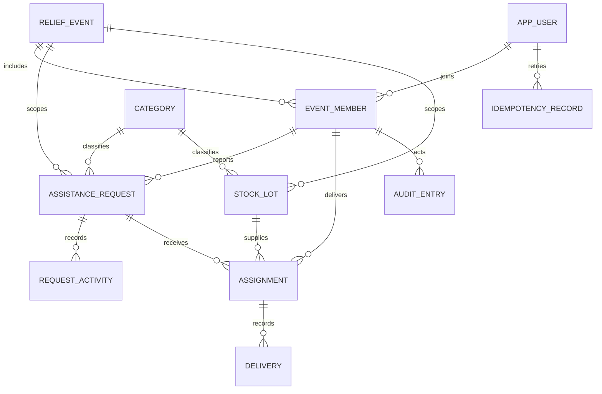
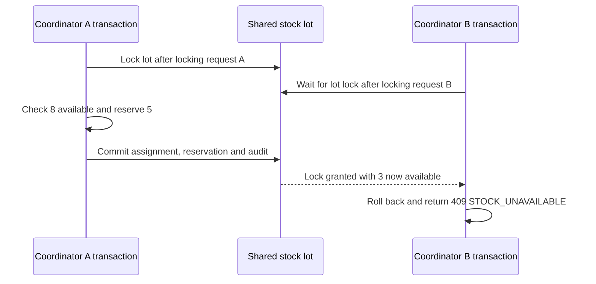

# Rebuild data and API contract

R01 design · 11 November 2026

The ER diagram is the logical model. The [microservices architecture](ARCHITECTURE.md#service-ownership) identifies which relationships cross service boundaries and which are enforced within a service database.

## Data model

| Entity | Key fields and relationships |
|---|---|
| Event and membership | Event ID, active flag and service area. User ID and unique OIDC issuer and subject pair. One membership per event and user, with a database-owned role. |
| Category | Category code and fixed unit. Requests and lots reference the category and return its unit in the API. |
| Assistance request | Event, resident, category, requested quantity, description, exact location, general area, review state, verified quantity, verified urgency, version, timestamps and optional duplicate-of request in the same event. Verified fields are required in the verified state and null in other states. |
| Request activity | Request, actor, timestamp and action. Clarifications and replies store their text. Rejections store a resident-facing reason. Related-report actions store the linked request ID. Verification stores independent source type and synthetic reference, confirmed quantity, urgency and rationale. Source and rationale are coordinator-only. |
| Stock lot | Event, category, location, total usable quantity received including adjustments, quantity reserved, quantity delivered and version. The lot retains its original category and unit. |
| Assignment | Request, lot, volunteer, state, assigned quantity, delivered quantity, optional delivery instructions and version. Request, lot and volunteer membership belong to the same event. |
| Delivery | Assignment, positive delivered quantity, recording volunteer and server timestamp. Each successful delivery appends one record. |
| Audit entry | Event, actor, operation, entity ID, server timestamp and state or quantity change. Append in the same transaction as the action. Store protected verification notes in request activity. |
| Idempotency record | Unique actor and operation key, fingerprint of the HTTP method, route including entity IDs, and validated command, plus the committed response status and body. |

Use explicit migrations and parameterized SQL through `pg` (node-postgres). Check out one client for each transaction and use it for `BEGIN`, all statements and `COMMIT` or `ROLLBACK`. For distance filtering, PostGIS supports `ST_DWithin` in meters on indexed `geography(Point, 4326)` columns. R02 will verify these choices against the selected PostgreSQL/PostGIS image. [node-postgres transactions](https://node-postgres.com/features/transactions), [parameterized queries](https://node-postgres.com/features/queries), [PostGIS distance filtering](https://postgis.net/docs/ST_DWithin.html).

## Quantity and state rules

- Preserve the submitted quantity. The independently confirmed quantity becomes the fulfilment target. Both are positive integers in the category unit.
- Lot availability is `received - delivered - reserved`. Enforce nonnegative counters and `delivered + reserved <= received`. A stock adjustment must preserve that inequality and record a reason.
- Active assignments are `assigned`, `accepted` and `in_transit`. Each holds `assigned - delivered` units. Lot reserved quantity equals the sum of these holds on the lot. Lot delivered quantity equals the sum of deliveries against its assignments.
- For a verified request, outstanding need is `verified - delivered`. Allocatable need is outstanding need minus the holds on its active assignments. Both must be nonnegative. The request is fulfilled when outstanding need reaches zero.
- A delivery reduces the lot's reserved count and increases its delivered count by the same amount. Add the delivery record and update the assignment together. A partial delivery leaves the assignment in transit. An assignment completes when its delivered quantity equals its assigned quantity.
- Cancellation marks the assignment cancelled and reduces the lot's reserved count by the undelivered balance. Previously delivered units remain in the delivery history. Only active assignments can be cancelled.
- Use foreign keys and row-level `CHECK` constraints for relationships and bounds that fit a row. Maintain sums across tables through the transactions that change assignments, deliveries or lots.

## HTTP API

Paths are relative to `/v1/events/{eventId}`. Resolve the actor and role from the authenticated account and event membership. A resident reads their own reports, including their exact location and description. Coordinators can read event reports and verification activity. Volunteers read their own assignments, with general area visible on the offer and exact location and delivery instructions available only in accepted or in-transit assignments.

| Method and path | Actor and input | Success |
|---|---|---|
| `POST /requests` | Resident. Category, unit, quantity, description and location. | `201` submitted request |
| `GET /requests`, `GET /requests/{id}` | Resident or coordinator. List supports review state and verified urgency filters. | `200` scoped reports or report detail with visible activity |
| `POST /requests/{id}/clarifications` | Coordinator. Version and question. Submitted → needs clarification. | `200` updated request |
| `POST /requests/{id}/replies` | Owning resident. Version and reply. Needs clarification → submitted. | `200` updated request |
| `POST /requests/{id}/verification` | Coordinator. Version, confirmed quantity, urgency, source and rationale. Confirm need and location within the active event. Submitted → verified. | `200` updated request |
| `POST /requests/{id}/rejection` | Coordinator. Version, resident-facing reason and optional confirmed duplicate ID. Submitted → rejected. | `200` updated request |
| `POST /requests/{id}/related-reports` | Coordinator. Version and related request ID. Record the link without a review transition. | `200` updated request |
| `POST /stock-lots` | Coordinator. Category, unit, received quantity and location. | `201` lot with available and reserved quantities |
| `GET /stock-lots`, `GET /stock-lots/{id}` | Coordinator. List supports category filter. | `200` lot list or detail |
| `PATCH /stock-lots/{id}` | Coordinator. Version, updated received quantity or location, and reason for a quantity adjustment. | `200` updated lot |
| `GET /requests/{id}/matches` | Coordinator. Verified request. Filter compatible available lots and rank a bounded snapshot. | `200` candidates with lot ID, availability, distance and explanation, plus the request version |
| `POST /assignments` | Coordinator. Request ID and version, lot ID, volunteer ID, quantity and optional instructions. | `201` assignment with current quantities |
| `GET /assignments`, `GET /assignments/{id}` | Coordinator or assigned volunteer. List supports assignment state filter. | `200` scoped assignments or assignment detail |
| `POST /assignments/{id}/acceptance` | Assigned volunteer. Version. Assigned → accepted. | `200` updated assignment |
| `POST /assignments/{id}/transit` | Assigned volunteer. Version. Accepted → in transit. | `200` updated assignment |
| `POST /assignments/{id}/deliveries` | Assigned volunteer. Version and actual quantity. In transit → in transit or completed. | `201` delivery and updated assignment |
| `POST /assignments/{id}/cancellation` | Coordinator. Version and reason. Active → cancelled. | `200` updated assignment |

Validate IDs, enum values, required nonblank text, integer quantities in the database range, the category-unit pair, and finite longitude and latitude in range. A lot can be adjusted down to zero if it has zero deliveries and reservations. Persist server-generated IDs and timestamps. List endpoints use an opaque cursor over `(createdAt, id)` in descending order, with a default limit of 25 and maximum of 100. Keep the same filters on subsequent pages.

Return errors as `{ code, message, details? }`.

| Status | When to return it |
|---|---|
| `400` | Malformed input or a field fails validation. |
| `401` | Authentication is missing or invalid. |
| `403` | The caller lacks the role required for the action. |
| `404` | The resource is missing or outside the caller's visibility. |
| `409` | Stale version, invalid state transition, insufficient stock or allocatable need, or an operation key reused with different input. |
| `503` | Access cannot establish current permissions, or the matching endpoint cannot obtain a ranking. Retry writes with the original operation key. |

Conflicts may include current versions and quantities visible to the caller. Mutations check the supplied version under lock and return the new version. Changes to request progress or allocatable need also advance the request version. Lot balance changes advance the lot version. Creating an assignment rechecks current lot eligibility and availability because matches come from a snapshot.

Every mutation carries an `Idempotency-Key`. Check current authorization before replay. Claim the actor and key in the same transaction as the change. A concurrent identical-key call waits for that claim. After commit, an identical fingerprint replays the stored status and body before checking the entity version. A changed fingerprint returns `409`. A rollback removes the claim so a retry can execute. Store mutation responses without exact locations, delivery instructions or protected notes. Clients read those fields through authorized detail endpoints.

## Allocation transaction

Check the actor's permission and obtain the proposed volunteer's membership status from Access before starting the database transaction. Use the volunteer eligibility result only for a new assignment. An authorized replay returns its stored result. Use PostgreSQL Read Committed and claim the idempotency key before taking entity locks. Use separate `SELECT ... FOR UPDATE` statements in a consistent order for stock and request quantity changes. The first transaction to acquire a row lock proceeds, and PostgreSQL releases its locks at commit or rollback.

1. Lock the request row. Recheck event, review state and version. Calculate delivered and held quantities in a separate query after acquiring this lock so the totals include any allocation that committed while waiting.
2. Lock the stock-lot row. Read its current balances. Check event, category, unit, allocatable need and availability. Check that the authorized volunteer membership is for the same event. A match snapshot can guide the coordinator's choice.
3. Increase the lot's reserved quantity, insert the assignment in the assigned state, advance the request and lot versions, and insert the audit entry. Store the successful response with the idempotency key and commit together. Roll back the whole transaction if a check or write fails.

Delivery and cancellation acquire the same request and lot locks, then lock the assignment before checking its state and version. The parent IDs are immutable and can be read before locking. Acceptance and transit change the assignment state and version only and acquire only the assignment lock. Inventory edits acquire only the lot lock. Retry a bounded number of times on a database deadlock or serialization failure by starting a fresh transaction with the original key. Return business conflicts to the caller for a fresh decision. [PostgreSQL Read Committed and row locks](https://www.postgresql.org/docs/current/transaction-iso.html#XACT-READ-COMMITTED).

## Allocation and delivery walkthroughs

### Two requests compete for one stock lot

Two coordinators each try to allocate 5 water cases from a lot with 8 available. Their requests are different and each can accept 5 cases.

The lot ends with 5 reserved, 0 delivered and 3 available. Exactly one assignment and its audit entry commit. The conflict response includes current availability, so the second coordinator can select another lot or explicitly submit a smaller allocation under a new operation key.

### One request competes across two lots

One verified request can allocate 8 cases. Two coordinators each try to allocate 5 using different lots. The first locks the request and its chosen lot, reserves 5 and advances the request version. The second waits on the same request row. After the first commits, a fresh read shows the newer version and 3 allocatable cases. Its original command returns `409 STALE_VERSION`. A fresh command for 5 also fails with `409 INSUFFICIENT_NEED`. Its lot balance stays unchanged.

### Partial delivery and cancellation

A verified request needs 10 water cases. Start with 10 cases in one lot. The first assignment reserves 8. The volunteer records 5 delivered and the coordinator cancels the active assignment, releasing the remaining 3. A second assignment delivers the outstanding 5.

| Action | Lot available | Lot reserved | Delivered | Request outstanding | Request allocatable |
|---|---:|---:|---:|---:|---:|
| Initial | 10 | 0 | 0 | 10 | 10 |
| Reserve 8 | 2 | 8 | 0 | 10 | 2 |
| Deliver 5 | 2 | 3 | 5 | 5 | 2 |
| Cancel remaining 3 | 5 | 0 | 5 | 5 | 5 |
| Reserve remaining 5 | 0 | 5 | 5 | 5 | 0 |
| Deliver final 5 | 0 | 0 | 10 | 0 | 0 |

A retry of the first delivery with its original key returns the recorded response and creates zero additional delivery records. If a delivery and a cancellation target the same assignment concurrently, whichever commits first advances its version. The other rechecks the state and version after acquiring the locks. A coordinator cancelling after a partial delivery must refresh and release only the latest undelivered balance.
